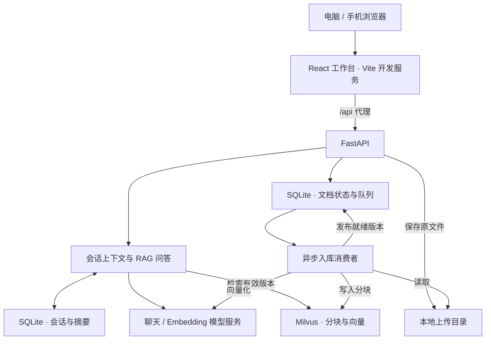

<p align="center">
  
</p>

# Super Assintant

以对话为核心的个人 AI 工作台，将文档上传、知识库检索、多轮问答与来源追溯整合到一个界面中。

前端采用暖灰与陶土橙的 **Warm Neumorphism（温润新拟物）** 设计，支持浅深主题及手机访问；后端基于 **FastAPI、SQLite、Milvus 和 OpenAI 兼容模型接口**。代码仓库名保留为 `DevKnowledge`。

## 当前功能

| 能力 | 已实现内容 | 当前边界 |
| --- | --- | --- |
| AI 对话 | 普通聊天与知识库模式、服务器会话、历史分页、失败重试与刷新恢复 | 非流式输出，暂不支持停止生成 |
| 会话上下文 | 最近完整问答、增量历史摘要、连续追问改写 | 用于延续当前会话，尚无跨会话长期记忆 |
| RAG 知识库 | 文档解析、清洗分块、向量化、范围过滤、相似度筛选与带引用回答 | 支持文本型资料，扫描 PDF 需先做 OCR |
| 入库任务中心 | 持久化排队、状态查询、失败重试、租约与心跳恢复 | 目前仅管理文档入库任务，无通用 Agent 执行时间线 |
| 文件库 | 多文件上传、搜索筛选、列表/网格、文档信息与用于问答 | 暂无原文件预览、下载、删除及生成作品管理 |
| 工作台交互 | 文档检索范围、引用原文、摘要查看、代码复制、回答 Markdown 导出、全局名称搜索 | 搜索已加载的会话标题和上传文档名称，不是全文搜索 |
| 多端与外观 | 可折叠导航、上下文面板、浅深主题、响应式布局 | 当前为共享个人空间，没有账号隔离 |

**Agent 工具调用、MCP、自动化、跨会话长期记忆和 Docker 部署尚未实现。** 完成程度与后续路线见 [八项能力核查](docs/capability-audit.md)。

## 快速开始

以下命令以 **Windows PowerShell** 为例，均从项目根目录开始。

### 1. 准备环境

- Python **3.11+**。
- Node.js 与 npm，用于运行 React + Vite 前端。
- 可访问的聊天模型与 Embedding 服务，均需提供 OpenAI 兼容接口。
- 已启动的 Milvus；所选数据库需存在。当前 Python 客户端依赖范围为 `pymilvus>=2.6,<2.7`。

SQLite 随 Python 提供，无需单独安装数据库服务。

```powershell
python -m venv .venv
.\.venv\Scripts\python.exe -m pip install -r requirements.txt
```

### 2. 配置模型与数据库

在项目根目录创建 `.env`，按实际服务填写以下配置。已有配置时直接编辑，保留自己的密钥。

```dotenv
# 聊天模型
LLM_API_BASE_URL=https://你的模型服务地址/v1
LLM_API_KEY=你的聊天模型密钥
LLM_MODEL=你的账号可用的模型名称

# 文档与问题向量化；可与聊天模型使用不同服务
EMBED_API_BASE_URL=https://你的向量服务地址/v1
EMBED_API_KEY=你的向量模型密钥
EMBED_MODEL=你的账号可用的向量模型名称

# Milvus
MILVUS_URI=http://127.0.0.1:19530
MILVUS_TOKEN=
MILVUS_DB_NAME=default
MILVUS_COLLECTION=document_chunks
MILVUS_TIMEOUT=30
```

API 地址按服务商要求填写，通常包含 `/v1`。Milvus 无鉴权时 token 留空，`MILVUS_DB_NAME` 不要留空。首次入库会按实际向量维度创建集合；后续检索必须使用与入库一致的向量模型配置。

`.env` 不应提交到 Git；修改环境配置后需要重启后端。

### 3. 启动后端

```powershell
.\.venv\Scripts\python.exe -m uvicorn main:app --host 127.0.0.1 --port 8000
```

接口文档：[http://127.0.0.1:8000/docs](http://127.0.0.1:8000/docs)。

### 4. 启动前端

另开一个终端：

```powershell
cd front
npm install
npm run dev
```

电脑浏览器打开 [http://localhost:5173](http://localhost:5173)。前端通过 Vite 将 `/api/*` 转发到本机后端，模型密钥不放在浏览器配置中。

如需更换后端地址，在 `front/.env.local` 设置 `BACKEND_URL`，然后重启前端。默认值为 `http://127.0.0.1:8000`，配置示例见 [front/.env.example](front/.env.example)。

### 5. 手机访问

前端可以显式使用局域网启动命令：

```powershell
npm run dev:lan
```

手机与电脑连接同一 Wi-Fi，在手机浏览器打开 Vite 打印的 Network 地址，即 `http://电脑的Wi-Fi IPv4地址:5173`。不要在手机使用 `localhost`、`127.0.0.1` 或 `0.0.0.0`。已有前端运行时无需重复启动。

保持前后端终端开启；换网络后重新确认电脑 IP。后端仍可只监听 `127.0.0.1:8000`，由前端代理访问。连接超时的排查步骤见 [手机访问说明](docs/mobile-access.md)。

## 使用流程

1. **直接聊天**：切换“普通聊天”，输入问题并发送。
2. **上传资料**：通过输入区附件入口或文件库上传 PDF、DOCX、Markdown、UTF-8 TXT。
3. **等待入库**：在任务中心查看状态，失败时可以重试。
4. **查阅知识库**：切换“知识库”，选择全部资料或指定已入库文档后提问。
5. **查看依据**：点击回答中的引用编号，查看原文、文件名和可用页码；继续追问可沿用当前会话。

入库状态为 `queued → processing → ready / failed`。上传成功表示文件已保存并排队，只有 `ready` 状态的版本会用于检索。

无有效参考资料时，系统明确回复“当前知识库中没有足够的信息回答这个问题。”，不会自动切换为普通聊天。引用校验检查编号是否有效，不保证模型推断或事实本身正确。

“全部资料”包括服务器启用的上传资料与离线导入资料；文件库仅展示当前集合的网页上传文档。新建或切换会话会清除临时文档选择，失败重试始终使用原请求参数。

## 实现与数据流



文档先解析、清洗并按字符分块，优先在句尾或换行处切分，保留重叠及来源位置。问题向量化后，按有效入库版本和文档范围过滤，再进行 Top-K 检索、相似度筛选及上下文组装。

多轮问答使用最近完整轮次和较早历史摘要，默认保留最近 6 轮原文参与上下文。RAG 追问先改写为独立检索问题，每轮重新检索，不沿用旧引用编号。请求使用幂等标识，网络异常后先核对服务器状态，再决定是否重试。

## 接口概览

| 方法 | 路径 | 用途 |
| --- | --- | --- |
| `POST` | `/chat` | 普通聊天或知识库问答 |
| `POST` | `/conversations` | 创建会话 |
| `GET` | `/conversations` | 分页获取会话列表 |
| `GET` | `/conversations/{id}` | 获取会话历史与摘要 |
| `GET` | `/conversations/{id}/requests/{request_id}` | 核对请求状态 |
| `DELETE` | `/conversations/{id}` | 删除会话 |
| `POST` | `/conversations/import` | 手动导入旧浏览器记录 |
| `POST` | `/upload` | 上传单个文档并加入入库队列 |
| `GET` | `/documents` | 获取上传文档与入库状态 |
| `GET` | `/documents/{id}` | 获取文档信息 |
| `POST` | `/documents/{id}/retry` | 重试失败的入库任务 |

普通聊天示例：

```powershell
$payload = @{ user_input = '你好，请介绍一下你自己'; mode = 'chat' } | ConvertTo-Json
Invoke-RestMethod -Uri http://127.0.0.1:8000/chat -Method Post `
  -ContentType 'application/json; charset=utf-8' `
  -Body ([System.Text.Encoding]::UTF8.GetBytes($payload))
```

知识库请求将 `mode` 设置为 `rag`（默认值），可附加 `top_k`、`min_score` 和 `document_ids`。相似度分数不是答案正确率；省略文档范围表示查询全部启用资料，空列表表示不检索。

多轮调用需先创建会话，再向 `/chat` **同时提供** `conversation_id` 和本轮唯一的 `request_id`。同一次请求的重复提交或失败重试，复用原 ID 与原参数；新问题使用新请求 ID。

聊天响应中的成功字段沿用历史拼写 `sucess`，上传响应使用 `success`。聊天回答在 `data`，实际引用在 `citations`。完整字段与错误状态以接口文档和 [会话说明](docs/conversations.md)、[上传说明](docs/upload.md) 为准。

## 离线文档入库

除网页上传外，也可独立执行 CLI。以下示例中的 `data/example.md` 需替换为自己的文档路径。

```powershell
# 仅解析、清洗和分块，不连接模型或 Milvus
.\.venv\Scripts\python.exe -m src.workflow.data_storage "data/example.md" --dry-run --report output/dry_run.json

# 正式向量化并入库
.\.venv\Scripts\python.exe -m src.workflow.data_storage "data/example.md" --report output/ingestion_report.json

# 递归批量导入目录
.\.venv\Scripts\python.exe -m src.workflow.data_storage data --recursive --report output/ingestion_report.json
```

在线问答默认从 `output/ingestion_report.json` 读取离线成功版本，可通过 `RAG_INGESTION_REPORT` 指定其他报告。正式报告只包含本批次结果，不自动合并历史批次或选择每份文档的最新版本；报告会覆盖指定文件，dry-run 应使用独立路径。

相同文档版本使用稳定主键 upsert；内容或分块变化会产生新版本，旧版本保留。多批写入不具备文档级事务，失败可能留下部分分块，但未完成版本不会被在线问答启用。详见 [入库说明](src/workflow/data_storage/README.md) 和 [检索说明](src/workflow/data_retrieval/README.md)。

## 目录与数据存储

```text
DevKnowledge/
├── main.py                  # FastAPI 入口与客户端生命周期
├── configs/                 # 环境配置与日志
├── src/
│   ├── api/                 # 聊天、会话、上传与文档状态接口
│   ├── core/                # 上传校验与文件保存
│   ├── database/            # SQLite 存储与 Milvus 客户端
│   ├── llm/                 # 聊天与 Embedding 模型客户端
│   ├── prompts/             # 提示词
│   ├── schema/              # Milvus 文档 Schema
│   └── workflow/            # 问答、上下文、入库与检索编排
├── front/                   # React + TypeScript + Vite 工作台
├── tests/                   # 后端自动化测试
├── scripts/                 # 真实服务联调脚本
├── docs/                    # 使用、能力核查与设计说明
├── data/                    # 运行时文件与 SQLite 数据库
└── output/                  # 入库报告与联调输出
```

| 内容 | 默认位置 |
| --- | --- |
| 原始上传文件 | `data/uploads/` |
| 文档元数据与任务状态 | `data/documents.sqlite3` |
| 会话、消息、引用与摘要 | `data/conversations.sqlite3` |
| 文档分块、向量与来源元数据 | Milvus 的 `document_chunks` 集合 |
| CLI 正式入库报告 | `output/ingestion_report.json` |

运行时目录按需创建，`data/`、`output/` 和 `.env` 不提交 Git。备份应同时保留上传文件、SQLite 数据库、Milvus 数据及使用中的离线入库报告。

当前没有账号隔离，同一后端的访问设备共享会话与资料。聊天、追问改写、历史摘要和向量化会将相关文本发送至配置的模型服务。本机仅保存界面偏好、草稿和待核对请求等状态。

## 测试与验证

后端自动化测试使用模拟模型与数据库，不调用真实模型服务：

```powershell
.\.venv\Scripts\python.exe -m unittest discover -s tests -v
```

前端测试与生产构建：

```powershell
cd front
npm test
npm run build
```

浏览器界面回归使用明确的接口夹具，覆盖浅深主题、360–1440px 布局、引用、摘要、文档范围、代码复制、回答下载及滚动行为。默认需要本机 Chrome，可通过 `CHROME_PATH` 指定路径。

```powershell
# 在 front/ 执行；已有前端运行时，指定其地址
$env:FRONT_URL = 'http://127.0.0.1:5173'
node scripts/check-workbench.mjs
```

未设置 `FRONT_URL` 时，脚本会自行启动并关闭 Vite，需确保 5173 端口空闲。截图和报告保存在 `front/artifacts/workbench/`，界面夹具测试不等于真实模型联调。

真实联调入口如下，运行前应检查脚本所需的语料和配置。这些脚本会调用模型；上传联调会保存测试文档并写入 Milvus，会话联调会保留测试会话。

```powershell
# 在项目根目录执行
.\.venv\Scripts\python.exe -m scripts.check_live_chat
.\.venv\Scripts\python.exe -m scripts.check_live_upload
.\.venv\Scripts\python.exe -m scripts.check_live_conversations
```

## 后续优化

- **后端基础**：集中配置校验、统一业务异常与响应模型、增加健康检查和请求/阶段耗时记录。
- **任务可靠性**：完善续租异常、处理超时与恢复机制，记录真实入库阶段，再扩展通用任务。
- **RAG 质量**：建立固定评测集，测量召回、引用依据、耗时和调用次数，再优化分块与检索策略。
- **文档生命周期**：补齐预览、下载、删除与有效版本管理。
- **能力扩展**：逐步接入 Agent、MCP、生成产物管理及可由用户控制的长期记忆。
- **部署交付**：补齐 Docker、生产反向代理、健康检查、备份与恢复流程。当前 `npm run dev` 提供开发服务，生产部署需另行配置。

## 更多文档

| 文档 | 内容 |
| --- | --- |
| [前端启动与使用](front/README.md) | 开发运行、代理与浏览器验证 |
| [前端工作台](docs/frontend-workbench.md) | 页面、交互、设计系统与能力边界 |
| [手机访问](docs/mobile-access.md) | 局域网地址、连接要求与分层排查 |
| [多轮会话](docs/conversations.md) | 请求幂等、上下文预算、摘要与恢复 |
| [上传与状态管理](docs/upload.md) | 文件保存、入库状态与失败重试 |
| [文档入库](src/workflow/data_storage/README.md) | CLI、分块、模型一致性与版本规则 |
| [知识检索](src/workflow/data_retrieval/README.md) | 过滤、相似度与上下文组装 |
| [八项能力核查](docs/capability-audit.md) | 实现程度、缺失能力与优化顺序 |
| [品牌与 Logo](docs/branding/active-logo.md) | Super Assintant 名称与对话环图案 |
